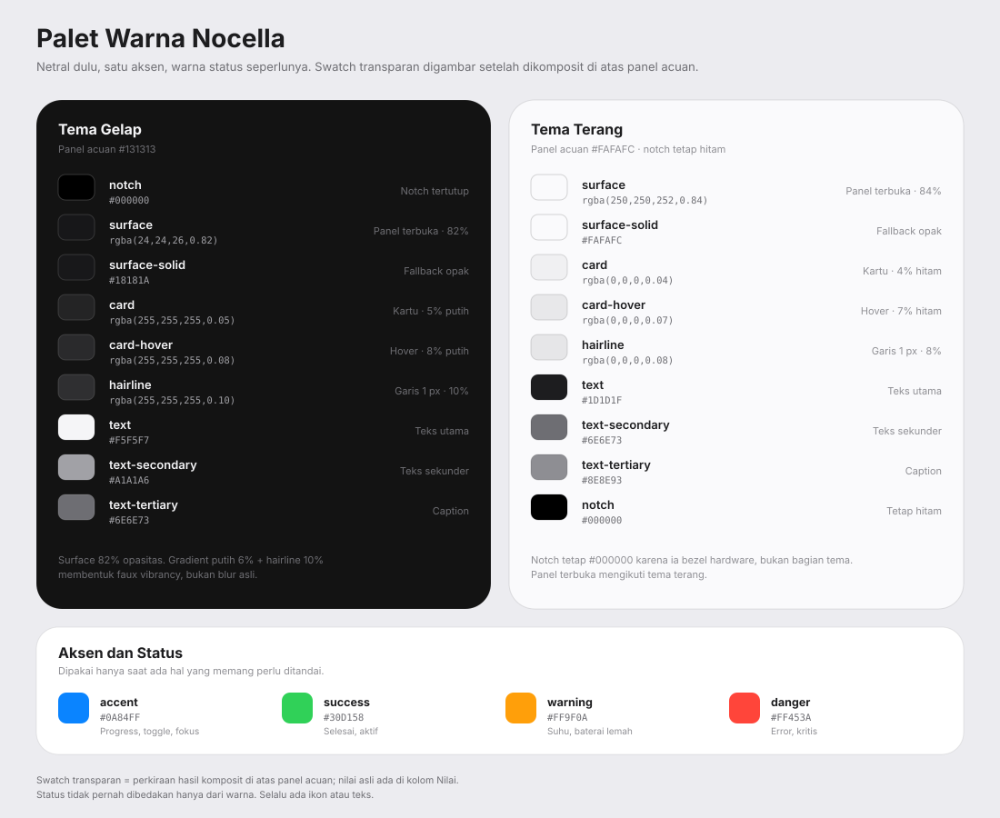

# 03. Desain Visual

Arah visual Nocella: **notch MacBook, perilaku Dynamic Island.**

MacBook memberi bentuknya: potongan hitam yang menyatu dengan tepi atas layar, sudut
atas siku, sudut bawah membulat, tanpa border yang mencolok. Dynamic Island memberi
perilakunya: membesar saat ada aktivitas, lalu mengecil lagi. macOS memberi bahasanya:
material gelap, tipografi kecil, satu aksen biru, dan banyak ruang kosong.

Nocella bukan tiruan macOS. Tidak ada traffic light, tidak ada kamera palsu, tidak ada
logo Apple. Yang diambil adalah rasa: tenang, presisi, dan tidak berlebihan.

## Prinsip visual

1. **Hitam dulu, warna kemudian.** Saat tenang, Nocella hanya hitam dan satu titik
   status. Warna muncul hanya ketika ada sesuatu yang perlu dilihat.
2. **Satu aksen.** Biru macOS `#0A84FF` dipakai untuk progress, toggle aktif, dan fokus.
   Status memakai hijau, oranye, dan merah secukupnya.
3. **Garis rambut, bukan bayangan tebal.** Pemisah 1 px dengan opasitas rendah. Bayangan
   hanya untuk panel terbuka, dan harus terasa lembut.
4. **Ruang kosong adalah fitur.** Jangan mengisi setiap piksel. Panel yang terasa lapang
   lebih mahal daripada panel yang penuh data.
5. **Gerak pendek dan tanpa bounce.** macOS tidak memantul. Nocella juga tidak.
6. **Jangan menipu.** Jangan menggambar kamera, speaker, atau sensor yang tidak ada.
   Notch adalah perangkat lunak, bukan hardware.

## Geometri

Semua angka untuk skala 1. St hanya mengalikan ukuran yang ditulis di CSS. Ukuran yang
diatur lewat JavaScript (`width`, `height`, posisi) dalam piksel device, jadi harus
dikalikan `St.ThemeContext.scale_factor`. `Main.panel.height` sudah dalam piksel device.

| Elemen | Ukuran | Radius | Catatan |
|---|---|---|---|
| Tinggi panel GNOME | 32 px | | `Main.panel.height` |
| Notch tertutup | 196 x 32 px | `0 0 16px 16px` | Menempel di `y=0`, sudut atas siku |
| Peek | 300 x 64 px | `0 0 20px 20px` | Hover |
| Transien media | 380 x 68 px | `0 0 20px 20px` | |
| Transien notifikasi | 420 x 92 px | `0 0 22px 22px` | |
| Transien volume | 320 x 60 px | `0 0 20px 20px` | |
| Panel terbuka | 420 x 220-340 px | `0 0 26px 26px` | Tinggi mengikuti tab |
| Padding panel | 16 px | | 12 px untuk peek/transien |
| Padding kartu | 12 px | | |
| Gap | 8 px | | Skala 4/8/12/16/20/24 |
| Ikon UI | 16 px | | Simbolik |
| Ikon aplikasi | 28 px | 8 px | Di notifikasi |
| Artwork transien | 48 px | 12 px | |
| Artwork pinned | 64 px | 14 px | |
| Tombol ikon | 32 x 32 px | 50% | Target klik minimum 32 px |
| Segmented control | 32 px tinggi | 10 px | |
| Switch | 40 x 24 px | 12 px | Knob 20 px |
| Slider | 4 px track | 2 px | Knob 14 px |

Posisi horizontal: `x = (monitor.width - width) / 2`, dibulatkan ke piksel utuh.
Posisi vertikal selalu `y = 0`. Nocella tidak pernah melayang di bawah panel.

Lebar 196 px dipilih karena mendekati lebar notch MacBook pada layar 14 inci. Kalau jam
memakai format 12 jam dengan AM/PM, lebar bertambah 10 px, bukan memotong teks.

## Bentuk

```
Tertutup, menempel di tepi atas:

════════════════════════════════════════════════════════
        ██████████████████████████████████
        █  14:32                      ●  █
        ▀▀▀▀▀▀▀▀▀▀▀▀▀▀▀▀▀▀▀▀▀▀▀▀▀▀▀▀▀▀▀▀
```

Sudut atas siku karena menyatu dengan tepi layar. Sudut bawah membulat 16 px. Tidak ada
border atas. Hairline bawah 1 px `rgba(255,255,255,0.06)` supaya bentuknya terbaca di atas
panel `#131313`. Hairline ini dibuat dengan inset shadow, karena St tidak mendukung border
per sisi. Nilainya sengaja 6%, lebih rendah dari token `hairline` 10% yang dipakai untuk
pemisah di dalam panel.

Saat terbuka, bentuknya tumbuh ke bawah seperti sheet macOS:

```
        ████████████████████████████████████████████
        █                   14:32                 ⌃  █
        █         [ ◷ ][ ♪ ][ ▤ ][ ● ][ ▦ ]          █
        █  ┌────────────────────────────────────┐  █
        █  │  ████   Judul Lagu                 │  █
        █  │  ████   Artis · Album              │  █
        █  │         ━━━━━━━━━━━━━━━━━━━━       │  █
        █  │         ⏮    ▶    ⏭     🔊 ━━━━   │  █
        █  └────────────────────────────────────┘  █
        ▀▀▀▀▀▀▀▀▀▀▀▀▀▀▀▀▀▀▀▀▀▀▀▀▀▀▀▀▀▀▀▀▀▀▀▀▀▀▀▀▀▀▀▀
```

Tidak ada jarak antara notch dan tepi atas. Panel terbuka terlihat seperti kelanjutan
dari notch, bukan kartu terpisah. Jam tetap di tengah header setinggi notch, persis di
tempatnya saat tertutup, sehingga tidak bergeser saat panel membuka. Segmented control
ada di baris tepat di bawah header, dan tombol tutup ada di tepi kanan header (diputuskan
di fase 2).

## Material dan kedalaman

Tiga tingkat material:

| Tingkat | Dipakai | Resep |
|---|---|---|
| 0 | Notch tertutup | Hitam `#000000`, tanpa bayangan, hairline bawah 6% |
| 1 | Peek dan transien | `rgba(18, 18, 20, 0.96)`, gradient tipis, bayangan lembut |
| 2 | Panel terbuka | `rgba(24, 24, 26, 0.82)`, gradient, hairline, bayangan besar |
| Kartu di dalam | Kartu media, notifikasi, metrik | `rgba(255, 255, 255, 0.05)`, radius 16 |

Resep faux vibrancy untuk panel terbuka:

```css
background-gradient-direction: vertical;
/* rgba(24, 24, 26, 0.82) with 6% white composited on top */
background-gradient-start: rgba(41, 41, 43, 0.83);
background-gradient-end: rgba(24, 24, 26, 0.82);
box-shadow: 0 24px 64px rgba(0, 0, 0, 0.55);
```

Di St, gradient menggantikan `background-color`. Karena itu kedua stop membawa warna
permukaan; stop putih transparan di atas `background-color` membuat panel tampak keruh
terang. St juga hanya menggambar satu `box-shadow`, dan daftar yang mencampur bayangan
luar dengan `inset` tidak digambar sama sekali. Kedua perilaku ini diuji di GNOME 46
pada fase 1.

St tidak punya `border-bottom` per sisi. Notch tertutup tidak punya bayangan luar, jadi
hairline 6%-nya memakai `box-shadow: inset 0 -1px 0`. Hairline 10% di panel terbuka
tidak bisa digabung dengan bayangan besar, jadi digambar oleh aktor terpisah di fase 7.

Ini bukan blur asli. St tidak punya `backdrop-filter`, dan `Shell.BlurEffect` memblur
isi aktor, bukan latar di belakangnya. Efek kaca dibuat dari translusensi, gradient, dan
hairline. Hasilnya cukup meyakinkan di atas wallpaper gelap. Di atas wallpaper terang,
panel tetap terbaca karena teksnya putih dan latarnya 82% opak.

Blur asli ditunda ke v2. Kalau nanti dipakai, hanya saat panel diam, bukan saat animasi
ukuran. Detail di `adr/0005-material-macos.md`.

## Warna

Palet token inti ada di [`palet-warna.svg`](palet-warna.svg). Gambar di bawah adalah versi
yang sama. Kalau tabel dan gambar berbeda, tabel di dokumen ini yang menjadi acuan.

[](palet-warna.svg)

*Swatch transparan menunjukkan perkiraan warna setelah dikomposit di atas panel acuan.
Nilai asli ada di kolom Nilai. Swatch per token disimpan di `docs/swatch/`. Kalau penampil
Markdown tidak merender SVG, buka [`palet-warna.png`](palet-warna.png).*

### Tema gelap

Panel acuan `#131313`.

| Warna | Token | Nilai | Pemakaian |
|---|---|---|---|
|  | `notch` | `#000000` | Notch tertutup |
|  | `surface` | `rgba(24, 24, 26, 0.82)`<br>`≈ #171719` | Panel terbuka |
|  | `surface-solid` | `#18181A` | Fallback tanpa transparansi |
|  | `card` | `rgba(255, 255, 255, 0.05)`<br>`≈ #242425` | Kartu di dalam panel |
|  | `card-hover` | `rgba(255, 255, 255, 0.08)`<br>`≈ #2A2A2C` | Hover kartu dan tombol |
|  | `hairline` | `rgba(255, 255, 255, 0.10)`<br>`≈ #2F2F31` | Pemisah 1 px |
|  | `text` | `#F5F5F7` | Teks utama |
|  | `text-secondary` | `#A1A1A6` | Artis, caption |
|  | `text-tertiary` | `#6E6E73` | Waktu, placeholder |

### Tema terang

Panel acuan `#FAFAFC`.

| Warna | Token | Nilai | Pemakaian |
|---|---|---|---|
|  | `surface` | `rgba(250, 250, 252, 0.84)`<br>`≈ #FAFAFC` | Panel terbuka |
|  | `surface-solid` | `#FAFAFC` | Fallback tanpa transparansi |
|  | `card` | `rgba(0, 0, 0, 0.04)`<br>`≈ #F0F0F2` | Kartu di dalam panel |
|  | `card-hover` | `rgba(0, 0, 0, 0.07)`<br>`≈ #E8E8EA` | Hover kartu dan tombol |
|  | `hairline` | `rgba(0, 0, 0, 0.08)`<br>`≈ #E6E6E8` | Pemisah 1 px |
|  | `text` | `#1D1D1F` | Teks utama |
|  | `text-secondary` | `#6E6E73` | Artis, caption |
|  | `text-tertiary` | `#8E8E93` | Waktu, placeholder |

Notch tertutup tetap hitam di tema terang:

| Warna | Token | Nilai | Pemakaian |
|---|---|---|---|
|  | `notch` | `#000000` | Notch tertutup, sama di kedua tema |

Itu meniru hardware MacBook: notch adalah bagian dari bezel, bukan bagian dari tema. Panel
terbuka mengikuti tema.

### Aksen dan status

Dipakai hanya saat ada hal yang memang perlu ditandai. Nilainya sama di kedua tema.

| Warna | Token | Nilai | Pemakaian |
|---|---|---|---|
|  | `accent` | `#0A84FF` | Progress, toggle, fokus |
|  | `success` | `#30D158` | Selesai, aktif |
|  | `warning` | `#FF9F0A` | Suhu, baterai lemah |
|  | `danger` | `#FF453A` | Error, kritis |

Alpha komponen seperti latar segmented control (`0.06`), segmen aktif (`0.14`), track switch
(`0.16`), dan slider (`0.14`) ada di bagian Komponen. Tabel di atas hanya token inti.

Kontras:

- `#F5F5F7` di atas `#18181A`: sekitar 16.3:1.
- `#A1A1A6` di atas `#18181A`: sekitar 6.9:1.
- `#6E6E73` di atas `#18181A`: sekitar 3.5:1, hanya untuk caption dan waktu.
- `#0A84FF` di atas `#000000`: sekitar 5.8:1, aman untuk teks besar dan ikon.
- `#0A84FF` di atas `#18181A`: sekitar 4.9:1. Jangan dipakai untuk body; biru adalah
  warna aksi, bukan warna teks.

## Tipografi

Font stack:

```css
font-family: "SF Pro Text", "SF Pro Display", "Inter",
             "Ubuntu Sans", "Cantarell", sans-serif;
```

SF Pro tidak tersedia di Linux dan tidak boleh didistribusikan. Inter adalah pengganti
terdekat dan bisa dipasang dengan `sudo apt install fonts-inter`. Kalau tidak ada,
Ubuntu Sans atau Cantarell tetap terlihat bersih. Jangan memaksa font yang tidak ada.

| Peran | Ukuran | Berat | Warna | Catatan |
|---|---|---|---|---|
| Jam | 13 px | 600 | text | Tabular |
| Judul konten | 13 px | 600 | text | Letter spacing -0.1 px |
| Body | 12 px | 400 | text | |
| Sekunder | 11 px | 400 | secondary | Artis, album |
| Caption | 10 px | 500 | tertiary | Waktu, label tab |
| Metrik | 18 px | 600 | text | Tabular |
| Tombol | 12 px | 500 | text | |

Aturan:

- Angka waktu dan metrik memakai `font-feature-settings: "tnum"`.
- Tidak ada teks semua kapital.
- Satu baris maksimal 42 karakter sebelum elipsis.
- Jangan memakai ukuran piksel untuk teks yang harus ikut text scaling. Pakai `em`
  relatif terhadap font shell, atau `pt` dengan nilai setara.
- Tinggi baris 1.3.

Angka px di tabel adalah acuan visual pada skala 1. Di stylesheet, 13 px setara dengan
9.75 pt. Pakai `pt` atau `em` supaya text scaling GNOME ikut bekerja; jangan mengunci
semuanya dalam px.

## Komponen

### Segmented control

Tab di header memakai segmented control ala macOS, bukan underline.

```
┌────────────────────────────────────────┐
│  [ ◷ ]  [ ♪ ]  [ ▤ ]  [ ● ]  [ ▦ ]    │
└────────────────────────────────────────┘
```

- Kontainer 32 px, radius 10, latar `rgba(255,255,255,0.06)`, padding 2.
- Segmen 28 x 28, radius 8.
- Segmen aktif: latar `rgba(255,255,255,0.14)`, ikon putih, bayangan dalam tipis.
- Segmen pasif: ikon `#A1A1A6`.
- Indikator aktif bergeser 180 ms, bukan crossfade.
- Label teks hanya muncul kalau lebar panel >= 480 px. Di bawah itu, ikon saja.

Ikon tab: hari ini `◷`, media `♪`, sistem `▤`, agen `●`, workspace `▦`. Notifikasi
tidak punya tab sendiri; daftarnya menyatu dengan tab "Hari ini", seperti Notification
Center macOS.

### Tombol ikon

- 32 x 32, radius 50%.
- Default transparan.
- Hover `rgba(255,255,255,0.08)`.
- Aktif `rgba(255,255,255,0.12)`.
- Tekan: skala 0.94 selama 90 ms.
- Fokus: outline 2 px `#0A84FF` dengan offset 2 px.

### Switch

- Track 40 x 24, radius 12.
- Off: `rgba(255,255,255,0.16)`.
- On: `#0A84FF`.
- Knob 20 px putih, bayangan `0 1px 3px rgba(0,0,0,0.4)`.
- Transisi 180 ms.
- Seluruh track adalah target klik, bukan hanya knob.

### Slider

- Track 4 px, radius 2, `rgba(255,255,255,0.14)`.
- Isi: `#0A84FF`.
- Knob 14 px putih, membesar 16 px saat hover.
- Saat drag, knob 18 px dan track 5 px.
- Volume: ikon speaker di kiri, persentase 11 px di kanan.
- Brightness: ikon matahari di kiri.

### Kartu

- Latar `rgba(255,255,255,0.05)`.
- Radius 16.
- Padding 12.
- Tanpa border. Pemisah antar kartu memakai gap 8 px, bukan garis.
- Hover hanya untuk kartu yang bisa diklik: `rgba(255,255,255,0.08)`.

### Notifikasi

```
┌──────────────────────────────────────────┐
│  ███   Telegram                     2m   │
│  ███   Budi: rapat jam 3 jadi?           │
│        [ Buka ]   [ Tandai dibaca ]      │
└──────────────────────────────────────────┘
```

- Ikon aplikasi 28 px, radius 8.
- Judul 13/600, isi 12/400 secondary.
- Waktu 10/500 tertiary di kanan atas.
- Aksi utama: pill biru `#0A84FF`, tinggi 28, radius 14, teks putih 11/600.
- Aksi sekunder: pill `rgba(255,255,255,0.08)`, teks 11/500.
- Maksimal dua aksi. Sisanya di menu `...`.

### Metrik sistem

```
CPU      12%    ▁▂▃▅▆▅▃▂▁▂▃▅
RAM      4.2 / 15.6 GB
Disk     61%
Network  ↓ 1.2 MB/s   ↑ 240 KB/s
Suhu     52°C
```

- Label 11 px secondary, lebar tetap 64 px.
- Nilai 13 px/600 tabular.
- Sparkline 80 x 20, garis 1.5 px accent, area 10% opacity.
- Baris 32 px, tanpa garis pemisah. Gap 4 px.

### Badge dan status

- Titik 6 px, tanpa angka di collapsed.
- Biru: ada sesi agen aktif.
- Hijau: selesai.
- Oranye: menunggu izin.
- Merah: error.
- Abu-abu: tidak ada aktivitas.
- Titik tidak berkedip dan tidak berdenyut. Hanya berubah warna.

## Motion

| Transisi | Durasi | Easing | Catatan |
|---|---|---|---|
| Buka | 300 ms | `cubic-bezier(0.22, 1, 0.36, 1)` | `EASE_OUT_QUINT` |
| Tutup | 220 ms | `cubic-bezier(0.4, 0, 1, 1)` | `EASE_IN_QUART` |
| Ganti konten | 160 ms | `EASE_OUT_QUAD` | Crossfade, delay 40 ms |
| Geser segmen | 180 ms | `EASE_OUT_QUAD` | Hanya indikator |
| Hover | 140 ms | `EASE_OUT_QUAD` | Latar |
| Tekan | 90 ms | `EASE_OUT_QUAD` | Skala 0.94 |
| Progress | linear | | Update 1 detik |
| Badge | 0 | | Tidak ada animasi |

Aturan:

- Tidak ada overshoot, bounce, atau spring. Itu bahasa iPhone, bukan MacBook.
- Jangan menganimasikan `width`/`height` sambil mengganti teks. Fade isi dulu, ubah
  ukuran, fade isi baru.
- Hormati `org.gnome.desktop.interface enable-animations`. Kalau mati, semua durasi 0.
- Animasi tidak boleh memblokir input. Klik saat animasi berjalan harus mempercepat ke
  state tujuan.

## State visual

| State | Bentuk | Isi | Material |
|---|---|---|---|
| Idle | 196 x 32 | Jam + titik status | Hitam pekat |
| Peek | 300 x 64 | Jam + satu baris ringkasan | Hitam 96% |
| Media | 380 x 68 | Artwork, judul, artis, progress | Hitam 96% |
| Notifikasi | 420 x 92 | Ikon, judul, isi, aksi | Hitam 96% |
| Volume | 320 x 60 | Ikon, slider, persentase | Hitam 96% |
| Pinned | 420 x 220-340 | Header, segmented control, konten | Kaca gelap 82% |
| Suppressed | 0 | Tidak ada | Tidak ada |

## Tema terang

- Notch tertutup tetap hitam.
- Panel terbuka memakai `rgba(250,250,252,0.84)`, teks `#1D1D1F`.
- Kartu memakai `rgba(0,0,0,0.04)`.
- Hairline `rgba(0,0,0,0.08)`.
- Aksen tetap `#0A84FF`.
- Bayangan lebih ringan: `0 24px 64px rgba(0,0,0,0.18)`.
- Jangan mengubah aksen menjadi lebih gelap; macOS memakai biru yang sama di kedua tema.

Deteksi tema lewat `St.Settings:color-scheme`, bukan menebak dari `gtk-theme`.

## Aksesibilitas

- Kontras teks body minimal 4.5:1.
- Fokus keyboard: outline 2 px `#0A84FF`, offset 2 px. Jangan hanya mengubah warna latar.
- Semua tombol punya `accessible_name`.
- Urutan fokus: header, segmented control, konten, tombol tutup.
- `Escape` menutup. `Tab` berputar di dalam panel saat pinned.
- Hormati text scaling. Panel tumbuh ke bawah, lebar maksimal 480 px.
- Hormati reduced motion.
- Status tidak boleh dibedakan hanya dari warna. Error memakai ikon dan teks.
- Pembaca layar harus mengumumkan notifikasi sekali, tidak dua kali.

## Yang boleh dan tidak boleh

Boleh:

- Hitam pekat, abu netral, satu biru.
- Garis rambut 1 px.
- Sudut membulat konsisten 8/12/16/22/26.
- Ikon tipis 1.5 px.
- Banyak ruang kosong.
- Animasi pendek.

Jangan:

- Gradient pelangi atau neon.
- Bayangan tebal dan gelap di semua elemen.
- Sudut membulat di semua hal sampai terlihat seperti kapsul.
- Font tebal di mana-mana.
- Ikon berwarna-warni kecuali ikon aplikasi.
- Meniru traffic light, dock, atau logo Apple.
- Kamera palsu di dalam notch.
- Teks semua kapital.
- Animasi memantul.

## Catatan implementasi St

- Tidak ada `backdrop-filter`. Gunakan translusensi dan gradient.
- Tidak ada variabel CSS. Token warna ditulis ulang di stylesheet atau dihasilkan dari
  JS saat enable.
- Tidak ada `display: flex`. Pakai `St.BoxLayout` dan `Clutter.BinLayout`.
- Tidak ada `@font-face`. Font harus terpasang di sistem.
- `border-radius: 0 0 16px 16px` didukung. `border-bottom` per sisi tidak didukung;
  pakai `box-shadow: inset 0 -1px 0` untuk hairline.
- `background-gradient-direction` dan `background-gradient-start/end` dipakai untuk
  gradient vertikal. Gradient menggantikan `background-color`, jadi kedua stop harus
  membawa warna permukaan.
- `box-shadow` hanya satu bayangan, luar atau `inset`. Campuran keduanya tidak
  digambar. Hairline plus bayangan besar butuh aktor terpisah.
- Jangan memasang `clip_to_allocation` pada aktor yang punya bayangan luar; bayangannya
  ikut terpotong.
- Untuk switch dan slider, gambar sendiri dengan `St.DrawingArea` dan Cairo supaya
  bentuknya persis. Jangan memakai widget GTK.
- Hairline 1 px CSS menjadi 2 px device pada skala 2. Itu benar, jangan dikompensasi.

## Yang belum diputuskan

- Blur asli saat panel diam.
- Apakah jam pindah ke kanan saat panel terbuka.
- Apakah tab memakai label teks di layar lebar.
- Apakah perlu suara halus saat buka/tutup. Default: tidak.
- Apakah notch menampilkan waveform saat media diputar. Default: tidak, cukup titik.
